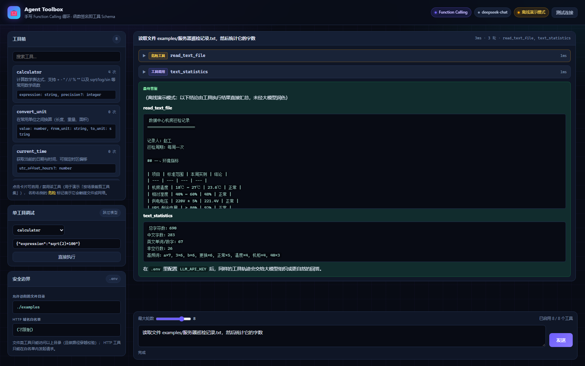
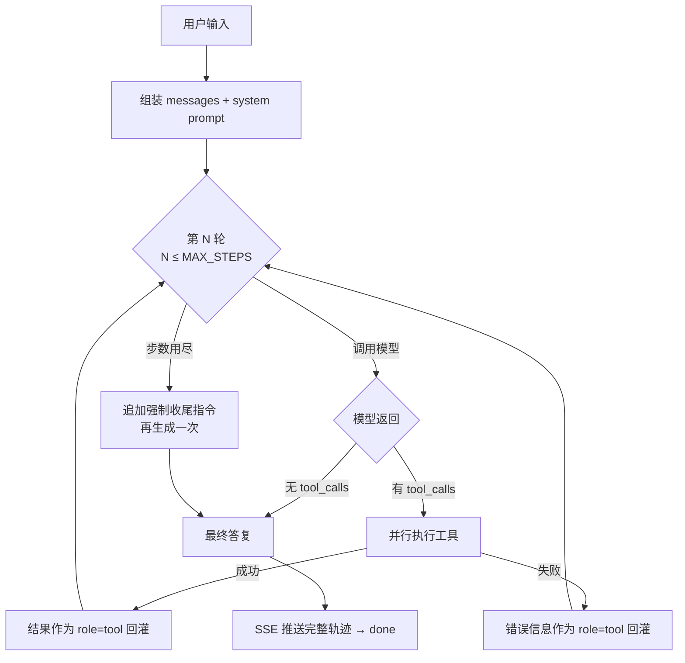

# Agent Toolbox · 智能体工具箱

> **函数签名即工具定义**——写一个工具只需要写一个普通 Python 函数。
> 不套 LangChain，手写 Function Calling 循环，把 Agent 的每一处细节都摊开讲清楚。

[](https://github.com/zhaosibo-1/agent-toolbox/actions/workflows/ci.yml)




---

## 这个项目在做什么

大模型本身只会「说话」，不会算数、不能上网、读不了你的文件。
**Agent 的本质就是给模型装上工具，并且让它自己决定什么时候用哪个工具。**

这个项目实现了一个完整可用的 Agent 运行时：

- 给它一句自然语言，它自己**规划 → 调用工具 → 观察结果 → 再规划**，直到能回答；
- 整个推理轨迹（思考 / 调用 / 观察 / 答复）通过 SSE **实时推到前端**，不是黑盒；
- 工具**失败也不会崩**——错误信息会回灌给模型，它往往能自己改参数重试；
- 工具**自带安全边界**——计算器走 AST 白名单、文件工具防路径穿越、HTTP 工具带域名白名单。

### 为什么不用 LangChain

框架能省事，但会把这些关键细节全藏起来：

| 自己写 | 用框架 |
| --- | --- |
| 工具 Schema 从**函数签名**自动生成，改签名 Schema 自动跟着变 | 常常要手写一份 JSON Schema，容易和实现脱节 |
| 工具报错 → 包成消息回灌模型，行为完全可见可测 | 错误怎么处理取决于框架版本，排查成本高 |
| 步数上限、超时、并行调用、降级策略都是显式代码 | 藏在配置和回调里，出问题只能读框架源码 |
| 核心实现约 570 行（含详尽中文注释），面试时能逐行讲清楚 | 「我调用了一个框架」 |

---

## 核心特性

### 1. 函数签名即工具 Schema

新增一个工具，**不需要写一行 JSON**：

```python
from app.tools import tool

@tool(description="查询某个城市的天气", dangerous=True)
def get_weather(city: str, days: int = 1) -> str:
    """查询指定城市未来若干天的天气。

    Args:
        city: 城市名称，例如「沈阳」。
        days: 查询天数，默认 1 天。
    """
    return f"{city} 未来 {days} 天：晴，18℃"
```

框架自动做的事：

- `city: str` → `{"type": "string"}`；`days: int = 1` → `{"type": "integer", "default": 1}`；
- **有默认值即选填**，自动生成 `required: ["city"]`；
- docstring 的 `Args:` 段自动变成每个参数的 `description`；
- `list[str]` / `Optional[X]` / `Literal["a","b"]` / `str | int` 都有对应的 Schema 映射；
- 参数表上显式写 `additionalProperties: false`，从入口挡掉「模型编造参数」这类幻觉。

> 这条设计守住了一个经典事故：**Schema 说必填、代码里其实可选**。
> 因为只有一份定义，不可能对不上。

### 2. 双通道 + 自动降级

| 通道 | 适用场景 | 机制 |
| --- | --- | --- |
| `function_call` | DeepSeek / 通义 / Kimi / 智谱 / GPT 等支持原生 tools 的模型 | 走标准 `tools` 参数 |
| `react` | 不支持 function calling 的开源模型 | 文本协议 `Thought / Action / Action Input / Final Answer` |

`AGENT_MODE=auto`（默认）时会先用 `function_call`；一旦服务端明确回「不认识 tools 参数」，
**自动切换到 ReAct 重跑一遍**，并把这个降级事件推给前端，不会静默失败。

### 3. 工具失败 = 一次观察，而不是一次崩溃

```python
try:
    payload = await registry.aexecute(call.name, arguments)
except ToolError as exc:
    error = str(exc)
    payload = f"错误：{error}"        # ← 作为 role=tool 消息回灌给模型
```

模型看到 `错误：calculator 缺少必填参数：expression。期望参数：expression: string, precision?: integer`
之后，通常下一轮就能把参数补对。这是 Agent 鲁棒性最关键的一环，也是**测试覆盖最重的路径**。

### 4. 全轨迹可观测

```
start → thinking → tool_call → tool_result → thinking → delta…×N → done → [DONE]
```

前端会把每一步渲染成时间线：调用了哪个工具、传了什么参数、返回了什么、耗时多少、是否危险操作。
排障时不需要猜，直接看轨迹。

### 5. 离线可跑（clone 下来就能看）

没有 API Key 也能把**完整的 Agent 循环**跑通：

- 规划阶段降级为**规则化 planner**（关键词 → 工具）；
- 工具执行、错误回灌、多步编排、SSE 推送**全都是真实的**；
- 所有离线输出都会明确标注「离线演示模式」，不会伪装成大模型生成。

这既保证了 `git clone` 后零配置可复现，也让 CI 不需要任何 secrets 就能端到端验收。

---

## 快速开始

```bash
git clone https://github.com/zhaosibo-1/agent-toolbox.git
cd agent-toolbox

python -m venv .venv
source .venv/bin/activate        # Windows: .venv\Scripts\activate
pip install -r requirements.txt

cp .env.example .env             # 不填 Key 也能跑（离线演示模式）
uvicorn app.main:app --reload
```

打开 <http://127.0.0.1:8000> 即可。

接真实大模型只需改 `.env`（一套代码兼容所有 OpenAI 协议服务）：

```dotenv
LLM_PRESET=deepseek              # deepseek | qwen | moonshot | zhipu | siliconflow | openai | custom
LLM_API_KEY=sk-your-key-here
# LLM_BASE_URL 和 LLM_MODEL 留空则使用 preset 的默认值
```

Docker 一键起：

```bash
docker compose up -d
```

---

## 项目结构

```
agent-toolbox/
├── app/
│   ├── config.py            # 配置 + 7 家厂商预设 + Key 脱敏
│   ├── schemas.py           # 前后端唯一契约（Pydantic）
│   ├── tools/
│   │   ├── base.py          # ★ @tool 装饰器 + 从函数签名生成 JSON Schema
│   │   ├── builtin.py       # 8 个内置工具（含 AST 安全计算器）
│   │   └── registry.py      # 注册表：收集 / 暴露 / 安全执行
│   ├── llm.py               # OpenAI 兼容客户端（含流式与错误翻译）
│   ├── offline.py           # 无 Key 时的规则化规划器
│   ├── agent.py             # ★ 主循环：规划 → 调用 → 观察 → 收敛
│   └── main.py              # FastAPI + SSE
├── web/index.html           # 深色科技风单页（零构建、零依赖）
├── examples/                # 文件工具的沙箱目录
├── tests/                   # 196 个测试
├── scripts/e2e_check.py     # 黑盒端到端验收（52 项断言）
├── Dockerfile / docker-compose.yml
└── .github/workflows/ci.yml
```

---

## Agent 主循环



关键设计点：

- **步数上限**（`MAX_STEPS`，默认 8）：硬截断，避免模型陷入「调工具 → 报错 → 再调同一个」的死循环；
- **同轮并行**：同一轮里互不依赖的多个工具调用走 `asyncio.gather` 并发执行；
- **单工具超时**：每个工具独立 `asyncio.wait_for`，一个工具卡死不会拖垮整个会话；
- **历史裁剪**：只保留最近 12 条 user/assistant 消息，防止上下文无限膨胀；
- **结果截断**：回灌给模型的工具结果有长度上限，避免一次读大文件把 token 打爆。

---

## 内置工具

| 工具 | 说明 | 安全边界 |
| --- | --- | --- |
| `calculator` | 数学表达式求值，支持 `sqrt/log/sin` 等 | **AST 白名单求值，不用 eval**；拒绝 `__import__`/`open`/属性访问；幂指数上限 1000 |
| `convert_unit` | 长度 / 重量 / 面积单位换算 | 跨量纲直接拒绝 |
| `current_time` | 当前时间，可指定时区偏移 | — |
| `text_statistics` | 字符数、词数、行数、高频词 | — |
| `json_query` | 按 `data.items.0.name` 点路径取字段 | 报错时列出可用键名 |
| `http_get` | 抓取网页正文（粗粒度去 HTML 标签） | 域名白名单 + 响应体上限 200KB + 10s 超时 |
| `list_directory` | 列出允许目录下的文件 | 路径穿越校验 |
| `read_text_file` | 读取允许目录下的文本文件 | 路径穿越校验 + UTF-8/GBK 自适应解码 |

### 计算器为什么不用 `eval`

`eval` 的沙箱几乎没有可靠做法。这里的实现是**先把表达式解析成 AST，再只放行白名单内的节点**：

```python
_ALLOWED_BINARY_OPS = {ast.Add, ast.Sub, ast.Mult, ast.Div, ...}
if type(node.op) not in _ALLOWED_BINARY_OPS:
    raise ToolError(f"不支持的运算符：{type(node.op).__name__}")
```

`__import__('os').system('ls')` 连语法层都过不去——这是**从根上杜绝**，而不是事后过滤关键字。

### 文件工具为什么必须做路径穿越校验

不做校验的话，模型可以让 Agent 去读 `../../.env`，把 API Key 读出来发到某个网页上。
所以校验必须发生在 `Path.resolve()` **之后**（只有这样才真正处理掉 `..` 和符号链接）：

```python
resolved = candidate.resolve()
if _containing_allowed(resolved) is None:
    continue          # 落在允许目录之外 → 直接跳过
```

---

## API

| 方法 | 路径 | 说明 |
| --- | --- | --- |
| `GET` | `/api/health` | 健康检查（含工具数、是否离线） |
| `GET` | `/api/config` | 脱敏后的配置（Key 只显示前后 4 位） |
| `GET` | `/api/tools` | 工具清单 + 自动生成的 JSON Schema |
| `POST` | `/api/tools/{name}/run` | **跳过模型**直接执行某个工具，调试神器 |
| `POST` | `/api/chat` | 一次性执行，返回完整轨迹 |
| `POST` | `/api/chat/stream` | SSE 流式执行，实时推送轨迹 |
| `GET` | `/api/stats` | 各工具调用次数统计 |
| `GET` | `/api/llm/ping` | 大模型连通性自检 |
| `GET` | `/api/examples` | 列出沙箱目录内的文件 |
| `POST` | `/api/examples/upload` | 上传示例文件（扩展名白名单 + 文件名清洗 + 大小上限） |

交互式文档：<http://127.0.0.1:8000/docs>

### SSE 事件一览

| 事件 | 载荷要点 |
| --- | --- |
| `start` | `mode` / `offline` / `tools` / `max_steps` |
| `thinking` | `index`（第几轮） |
| `thought` | `content`（模型在两轮工具之间的中间想法） |
| `tool_call` | `tool` / `arguments` / `dangerous` / `timeout` |
| `tool_result` | `tool` / `result` / `error` / `duration_ms` |
| `fallback` | 从 function calling 降级到 ReAct 的通知 |
| `delta` | `content`（最终答复的增量文本） |
| `done` | `answer` / `steps` / `steps_used` / `elapsed_ms` / `tools_called` / `usage` |
| `error` | `error` |

最后一定会补一条 `event: [DONE]`，前端据此收尾。

---

## 配置项

| 变量 | 默认 | 说明 |
| --- | --- | --- |
| `LLM_PRESET` | `deepseek` | 厂商预设，决定默认 `base_url` / `model` |
| `LLM_API_KEY` | 空 | 留空即进入离线演示模式 |
| `LLM_TEMPERATURE` | `0.1` | 工具调用场景建议低温 |
| `MAX_STEPS` | `8` | 单次任务最多工具调用轮数 |
| `AGENT_MODE` | `auto` | `auto` / `function_call` / `react` |
| `ENABLE_TOOL_RESULT_FEEDBACK` | `true` | 关掉则「只跑一轮工具就收尾」，省 token |
| `TOOL_TIMEOUT` | `15` | 单个工具执行超时（秒） |
| `ALLOWED_FILE_DIRS` | `./examples` | 文件工具允许目录，留空则禁用文件工具 |
| `HTTP_ALLOWED_HOSTS` | 空 | HTTP 域名白名单，**留空 = 不限制，生产务必收紧** |
| `CALC_MAX_LENGTH` | `200` | 计算器表达式最大长度 |
| `MAX_UPLOAD_MB` | `5` | 上传文件大小上限 |

---

## 测试

```bash
pip install -r requirements-dev.txt
pytest -v
```

**196 个测试，全程不需要任何 API Key。**

| 文件 | 覆盖内容 |
| --- | --- |
| `test_tool_schema.py` (27) | 类型映射、必填判定、docstring 解析、超时、异常包装 |
| `test_builtin_tools.py` (57) | 8 个工具的行为 + **代码注入 / 路径穿越 / SSRF 的拦截** |
| `test_registry.py` (26) | 收集、Schema 导出、参数校验、结果序列化 |
| `test_agent.py` (44) | 主循环每条分支：收敛、错误回灌、步数上限、ReAct、自动降级、离线端到端 |
| `test_api.py` (33) | HTTP 契约、SSE 事件序列、上传校验、状态码 |
| `test_frontend_contract.py` (9) | 扫前端源码，**和真实接口返回做字段差集** |

除了单测，还有一份黑盒端到端验收脚本，会对**真实运行的服务**打 52 项断言
（CI 里也会跑）：

```bash
uvicorn app.main:app --port 8111 &
python scripts/e2e_check.py http://127.0.0.1:8111
```

---

## 设计取舍

**为什么只在最终答复用流式，工具调用阶段不用？**
各家对 `tool_calls` 流式分片的字段实现差异很大，边收边拼容易在特定厂商上出错。
实用主义取舍：工具阶段非流式（拿到完整结构再解析），最终答复走真流式（保证打字机体验）。

**为什么内置一个「假的」离线规划器？**
它不是假装懂语义的模型，而是一个**规则化 planner**。价值在于：零配置可复现、CI 不需要密钥、
离线输出明确标注来源。配了 Key 之后这一层立刻被真实模型取代。

**为什么 `ToolSpec` 在注册时要复制一份？**
`@tool` 把 spec 挂在函数对象上，那是全局单例。注册表如果直接持有它，
调用统计和超时覆盖就会跨注册表互相污染。生产环境只有一个注册表时看不出问题，
但这是个真实的状态泄漏——测试把它抓出来了。

---

## 安全说明

- `.env` 已在 `.gitignore` 中，仓库里只有 `.env.example` 的**占位符**；
- 上传接口对扩展名做白名单、对文件名做清洗、对大小做限制；
- 所有文件访问都做路径穿越校验，HTTP 访问建议配置域名白名单；
- 容器以非 root 用户（uid 10001）运行。

## License

[MIT](LICENSE) © 2026 赵思博
